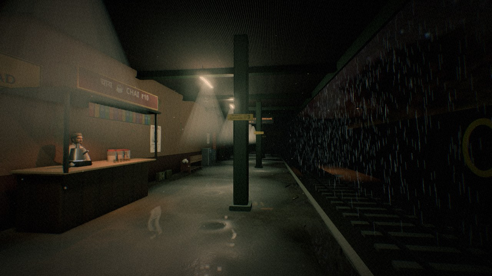
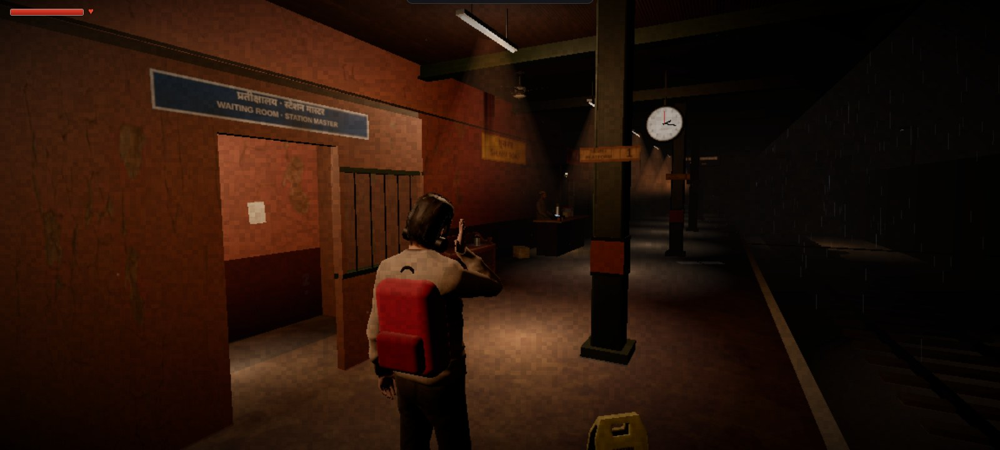
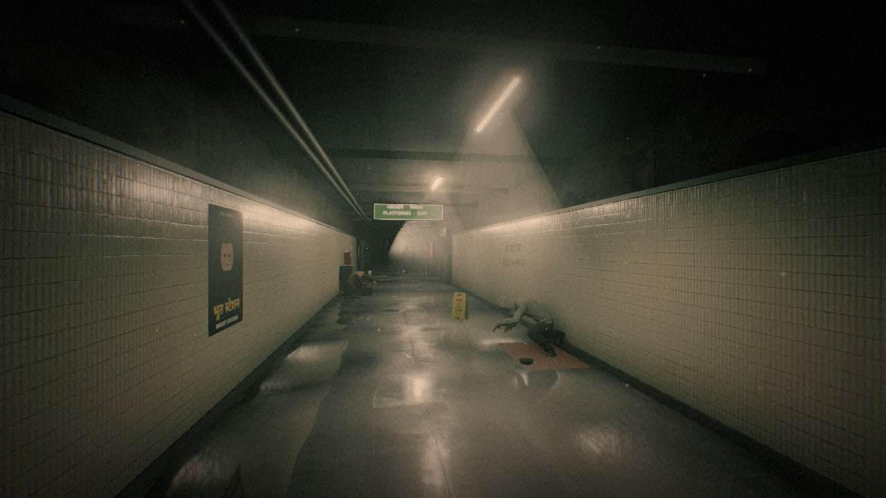
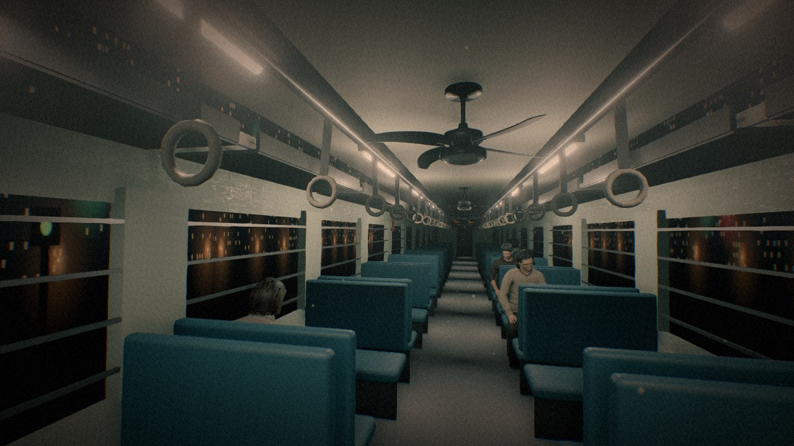

# PLATFORM 0

**A short horror anomaly game set on a late-night Indian railway platform.**
Spot what's wrong. Turn back. Play it free in your browser or on Android.

▶ **Play:** [sonujeet.itch.io/platform-0](https://sonujeet.itch.io/platform-0) · [platform-0.sites.tab.bot](https://platform-0.sites.tab.bot)



> 11:58 PM. Shunya Road station. The last local never came.

You're stuck in a loop on Platform 0: an empty, rain-soaked platform that keeps repeating. The chai stall.
The flickering tube lights. The man with the red backpack who walks past you every single time.
But sometimes, something is wrong.

## How to play

- If you spot an **anomaly**, **turn back**.
- If everything is **normal**, **keep going**.
- Right call: the number goes up. Wrong call: back to 0. Reach **8** to escape the chapter.
- Three chapters: **Platform 0**, **The Subway** beneath the tracks, and **The Last Local**.
- Dozens of anomalies to spot, from tiny details to things you won't forget, **+18 hidden anomalies**.
- Lost tickets and diary pages tell you what really happened on Platform 0. **3 endings.**
- Something in the station doesn't like being looked at. Hide, use your torch, and don't let it catch you.
- About 25 minutes for a first playthrough. Progress is saved at the start of each chapter.

Headphones strongly recommended.
*Content warning: jump scares, flashing lights, blood imagery, themes of death.*

## Controls

| Action | PC | Phone |
|---|---|---|
| Walk / run | WASD or arrow keys, hold **Shift** to run | Left thumb (push far to run) |
| Look | Mouse | Right thumb |
| Use / pick up / hide | **E** | **USE** |
| Torch | **F** | 🔦 |
| Torch flare | **Q** or right-click | 🔆 |
| Swing (when holding a rod or umbrella) | **R** or left-click | ⚔️ |
| Shove | **Space** | ✋ |
| First / third-person view | **V** | 🎥 |
| Pause | **Esc** | **II** (Android: back button) |

Play phones in landscape.

## Screenshots

| | |
|---|---|
|  |  |
|  |  |

## Tech

- **three.js** (WebGL) with plain JavaScript ES modules, no framework and no build step needed to run it
- Post-processing: bloom, GTAO, SMAA, depth of field, real-time reflections (three.js addons in `site/js/vendor/`)
- glTF models compressed with meshopt, PBR textures in three quality tiers (`texl/`, `tex/`, `tex2k/`), an HDRI sky
- Procedural **WebAudio** soundscapes per platform plus voiced PA announcements (English + Hindi)
- Graphics presets Low / Medium / High, auto-picked for the device; touch controls on phones
- **Android:** a [Capacitor 6](https://capacitorjs.com) wrapper around the same web game (`android-app/`)

## Project layout

```
site/            the whole web game (open site/index.html through a local server)
  js/            game code: engine, chapters (ch1-3), anomalies, NPCs, audio, HUD, story
  js/vendor/     three.js addons
  models/ tex*/  glTF models and textures      audio/  voice + PA clips      hdr/  night sky
tools/           asset scripts (animation packing, low-quality asset generation; Node + glTF-Transform)
android-app/     Android wrapper (Capacitor): prep_web.sh, build.sh, android/ (Gradle project)
docs/            screenshots, STORY.md (the story bible, full spoilers)
```

## Run it locally

The game is a static site. Any local web server works (opening the file directly won't, because of ES modules):

```bash
cd site
python3 -m http.server 8000
# then open http://localhost:8000
```

## Build the Android APK

Requirements: Node 18+, JDK 17, Android SDK (API 34) with `ANDROID_HOME` set.

```bash
cd android-app
./build.sh        # npm ci → copy ../site into www/ + Android glue → npx cap sync → gradlew assembleRelease
```

The APK lands in `android-app/android/app/build/outputs/apk/release/`.

**Signing:** release signing is optional and uses your own key. Copy `android-app/keystore.properties.example`
to `android-app/android/keystore.properties` and fill in your keystore path and passwords. That file and every
`*.jks` / `*.keystore` are gitignored. Without it you get an unsigned release APK. No signing keys are in this repository.

## Credits

Made by **Sonujeet**: code, story, design and direction.
Third-party assets (Microsoft Rocketbox avatars, MIT; Poly Haven textures, HDRI and props, CC0; Noto Sans Devanagari, OFL;
three.js, MIT) are listed with their licences in [CREDITS.md](CREDITS.md).

## License

**Source-available, all rights reserved.** You're welcome to read the code; you may not copy, modify, redistribute
or republish it or the game. See [LICENSE](LICENSE). Third-party assets keep their own licences (see CREDITS.md).
